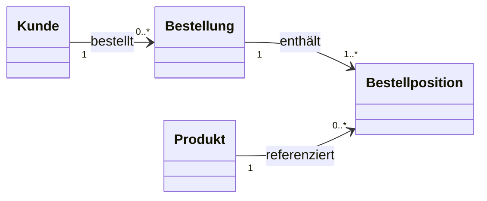
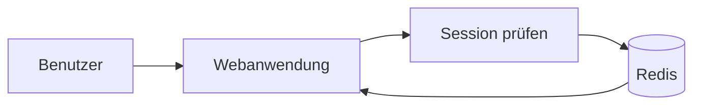
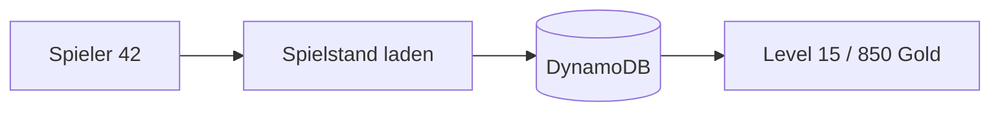
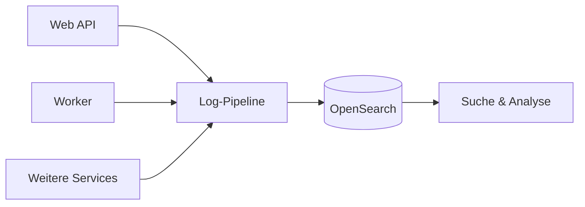

# Nicht alles muss in MySQL – ein Blick über den Datenbank-Tellerrand

*MySQL, Redis, DocumentDB, DynamoDB und OpenSearch: Welche Technologie eignet sich für welchen Anwendungsfall?*

MySQL ist ein echtes Arbeitspferd. Ob Onlineshop, Benutzerverwaltung oder klassische Webanwendung – mit einer relationalen Datenbank lässt sich erstaunlich viel umsetzen.

Aber nur weil man mit einem Schweizer Taschenmesser fast alles machen kann, ist es nicht automatisch das beste Werkzeug für jede Aufgabe.

AWS bietet eine ganze Reihe spezialisierter Datenbankdienste. Die spannende Frage ist dabei nicht, wie viele davon wir einsetzen können, sondern **wann eine andere Technologie tatsächlich Vorteile bringt.**

Schauen wir uns fünf typische Anwendungsfälle an.

## 1. RDS / Aurora – wenn Daten zusammengehören

Ein klassisches Beispiel ist ein Onlineshop.

Ein Kunde kann mehrere Bestellungen aufgeben. Jede Bestellung enthält mehrere Positionen, die wiederum auf Produkte verweisen.


Wenn ein Kunde bestellt, müssen wir mehrere Änderungen konsistent verarbeiten: Bestellung anlegen, Artikelbestand reduzieren und gegebenenfalls einen Zahlungsstatus aktualisieren.


*Abb. 1: MySQL / RDS: Eine Bestellung, eine Transaktion. Eigene schematische Darstellung mit Beispieldaten, [CC0](/sources.html#datenbank-tellerrand-illustrations).*

Genau hier spielen relationale Datenbanken ihre Stärken aus: **Joins, Fremdschlüssel und Transaktionen.**

Amazon RDS ermöglicht den verwalteten Betrieb von MySQL, PostgreSQL und weiteren relationalen Datenbanken. Aurora gehört zur RDS-Familie und bietet eine AWS-optimierte Architektur mit MySQL- oder PostgreSQL-Kompatibilität. Eine Datenbanktransaktion umfasst dabei nur die Änderungen in der Datenbank; ein externer Zahlungsanbieter wird dadurch nicht automatisch Teil derselben Transaktion.

**Merke**

Für strukturierte Geschäftsdaten mit Beziehungen und Transaktionen bleibt SQL eine hervorragende Wahl.

## 2. Redis / ElastiCache – schnelle Zugriffe auf kurzlebige Daten

Was passiert eigentlich, nachdem sich ein Benutzer erfolgreich bei einer Webanwendung angemeldet hat?

Die Anwendung muss bei weiteren Requests erkennen, dass der Benutzer bereits authentifiziert ist.

Eine mögliche Lösung: Login-Sessions in Redis speichern.
```yaml
# Schematische Darstellung, kein Redis-Befehl
key: session:abc123
value:
  userId: 42
  authenticated: true
ttl_seconds: 1800
```

Redis ermöglicht schnelle Zugriffe im Arbeitsspeicher. Mit einer Time to Live (TTL) lässt sich festlegen, wann ein Session-Eintrag automatisch abläuft.


AWS bietet mit ElastiCache einen verwalteten Dienst für In-Memory-Caching mit Valkey, Redis OSS oder Memcached. Redis ist also eine Technologie, ElastiCache der verwaltete AWS-Dienst.

Die TTL ist keine Haltbarkeitsgarantie: Je nach Konfiguration können Einträge bei Speicherdruck verdrängt werden; auch bei Ausfällen können Session-Daten verloren gehen. Die Anwendung muss fehlende Sessions sicher behandeln und gegebenenfalls eine erneute Anmeldung verlangen. Redis lässt sich auch mit Persistenz betreiben – „In-Memory“ bedeutet nicht grundsätzlich „ohne dauerhafte Speicherung“.


*Abb. 2: Redis: Die Session hat ein Ablaufdatum. Eigene schematische Darstellung mit Beispieldaten, [CC0](/sources.html#datenbank-tellerrand-illustrations).*

Redis eignet sich außerdem für Caching, Rate Limiting und andere kurzlebige Zustände.

**Merke**

Nicht alles muss dauerhaft gespeichert werden. Gerade für Sessions und Caches sind In-Memory-Technologien oft die passende Wahl.

## 3. DocumentDB – wenn nicht jeder Datensatz gleich aussieht

Stellen wir uns einen Onlineshop vor, der sehr unterschiedliche Produkte verkauft.

Ein Laptop besitzt Angaben zu Prozessor und Arbeitsspeicher. Ein T-Shirt hat eine Größe und Farbe.
```json
{
  "type": "laptop",
  "name": "Notebook",
  "cpu": "Ryzen 7",
  "ram_gb": 32
}
```
```json
{
  "type": "tshirt",
  "name": "T-Shirt",
  "size": "L",
  "color": "Black"
}
```

Beide Datensätze gehören zum Produktkatalog, haben aber unterschiedliche Attribute.

Natürlich könnte MySQL das auch mit JSON-Spalten abbilden. Dokumentendatenbanken wie Amazon DocumentDB bieten jedoch ein darauf ausgerichtetes Datenmodell mit entsprechenden Indizes und Abfragemöglichkeiten.

Das ist interessant, wenn Datenstrukturen variieren oder häufig neue Produktattribute hinzukommen. Unterschiedliche Attribute allein sind aber noch kein Grund für einen zusätzlichen Dienst: Entscheidend sind auch Abfragen, Indizes und die Frage, welche Daten gemeinsam geladen werden.

Amazon DocumentDB ist eine eigenständige Engine mit MongoDB-Kompatibilität, kein verwalteter MongoDB-Server. Unterstützte APIs und funktionale Unterschiede sollten wir für die gewählte Engine-Version prüfen.


*Abb. 3: DocumentDB: Gemeinsamer Katalog, andere Attribute. Eigene schematische Darstellung mit Beispieldaten, [CC0](/sources.html#datenbank-tellerrand-illustrations).*

**Merke**

Wenn Datensätze unterschiedlich aufgebaut sind und flexibel abgefragt werden sollen, kann eine Dokumentendatenbank sinnvoll sein.

## 4. DynamoDB – wenn Zugriffsmuster und Geschwindigkeit entscheidend sind

Stellen wir uns ein Online-Spiel vor, bei dem Millionen Spieler regelmäßig ihren Fortschritt speichern.

Beim Laden müssen wir normalerweise keine komplizierten Beziehungen auflösen. Wir wissen bereits, welchen Spielstand wir suchen.
```json
{
  "PK": "PLAYER#42",
  "SK": "SAVE#MAIN",
  "level": 15,
  "gold": 850,
  "location": "Dark Forest"
}
```

DynamoDB ist für genau solche gezielten Zugriffe mit niedrigen Latenzen ausgelegt.

DynamoDB unterstützt einen einfachen Primärschlüssel aus einem Partitionsschlüssel oder einen zusammengesetzten Primärschlüssel aus Partitions- und Sortierschlüssel. Im Beispiel bilden `PK` und `SK` gemeinsam den eindeutigen Schlüssel. `PK` und `SK` sind hier frei gewählte Namen für die Schlüsselattribute. Der Partitionsschlüssel (Partition Key) beeinflusst die Datenverteilung; der Sortierschlüssel (Sort Key) ordnet Einträge mit gleichem Partitionsschlüssel.


Der Dienst skaliert ohne klassische Datenbankserververwaltung. Allerdings sollten wir frühzeitig wissen, welche Abfragen unsere Anwendung benötigt. Gut verteilte Partition Keys helfen, Lastspitzen auf einzelnen Schlüsseln zu vermeiden. Weitere Zugriffsmuster können zusätzliche Indizes erfordern; ein vollständiger Scan ist kein gleichwertiger Ersatz für gezielte Schlüsselzugriffe.


*Abb. 4: DynamoDB: Der Zugriff beginnt beim Schlüssel. Eigene schematische Darstellung mit Beispieldaten, [CC0](/sources.html#datenbank-tellerrand-illustrations).*

Komplexe Joins oder beliebige relationale Abfragen sind nicht die Stärke von DynamoDB.

**Merke**

Besonders interessant für hohe Last und klar definierte Zugriffsmuster – nicht automatisch für jede kleine Datenbanktabelle.

## 5. OpenSearch – wenn aus einer Suche mehr als ein LIKE wird

Eine einfache Suche in MySQL ist schnell geschrieben:
```sql
SELECT *
FROM articles
WHERE title LIKE '%linux%';
```

Für viele Anwendungen reicht das aus. MySQL bietet außerdem eigene Volltextindizes – der nächste Schritt muss also nicht sofort ein zusätzlicher Suchdienst sein.

Was passiert aber, wenn Benutzer Tippfehler machen, Ergebnisse nach Relevanz sortiert werden sollen oder Millionen technische Logs durchsucht werden müssen?

Hier kommt Amazon OpenSearch Service ins Spiel.

Stellen wir uns eine Webanwendung mit mehreren Backend-Services vor. Ein Benutzer meldet einen Fehler, aber wir wissen nicht, welcher Service verantwortlich ist.

Mit OpenSearch können wir beispielsweise nach einer Request-ID suchen, Fehlermeldungen filtern oder Häufungen von HTTP-500-Fehlern erkennen.


OpenSearch ersetzt dabei nicht zwangsläufig die eigentliche Datenbank. Geschäftsdaten können weiterhin in MySQL liegen, während OpenSearch für Such- und Analyseaufgaben zuständig ist. Dafür müssen Änderungen zuverlässig in den Suchindex übertragen werden. Zwischen einer Änderung in MySQL und ihrer Sichtbarkeit in der Suche kann eine Verzögerung liegen; Relevanz und Tippfehlertoleranz hängen von der gewählten Abfrage und Indexkonfiguration ab.


*Abb. 5: OpenSearch: Von Logs zur Fehleranalyse. Eigene schematische Darstellung mit Beispieldaten, [CC0](/sources.html#datenbank-tellerrand-illustrations).*

**Merke**

Volltextsuche, Bewertung der Relevanz und die Analyse von Logs sind gute Gründe für eine spezialisierte Suchmaschine.

## Welche Datenbank für welchen Anwendungsfall?

| Anwendungsfall                                            | AWS-Dienst          | Besondere Stärke                     |
| --------------------------------------------------------- | ------------------- | ------------------------------------ |
| Onlineshop, Bestellungen, Transaktionen                   | RDS / Aurora        | Beziehungen und SQL                  |
| Login-Sessions, Caching, Rate Limiting                    | ElastiCache / Redis | Schnelle In-Memory-Zugriffe          |
| Produktkataloge, flexible JSON-Daten                      | DocumentDB          | Dokumentenmodell                     |
| Spielstände, Benutzerpräferenzen, viele Schlüsselzugriffe | DynamoDB            | Skalierbarkeit und niedrige Latenzen |
| Volltextsuche, technische Logs                            | OpenSearch          | Suche und Aggregation              |

Die Technologien schließen sich nicht gegenseitig aus.

Ein Onlineshop könnte seine Bestellungen in PostgreSQL speichern, Login-Sessions über Redis verwalten und OpenSearch für die Produktsuche verwenden.

Allerdings bedeutet jeder zusätzliche Dienst auch mehr Infrastruktur, Berechtigungen, Monitoring und Kosten.

## Und sonst?!

Bevor wir die nächste MySQL-Tabelle mit zwanzig optionalen Spalten anlegen, identische Abfragen tausendfach ausführen oder eine eigene Suchmaschine mit SQL nachbauen, lohnt sich vielleicht ein Blick auf die Alternativen.

Das bedeutet nicht, dass wir für jedes Feature sofort einen neuen AWS-Dienst benötigen.

**Die Frage sollte nicht nur lauten: „Kann MySQL das?“ – sondern: „Ist MySQL dafür das passende Werkzeug?“**

Manchmal lautet die Antwort weiterhin Ja.

Und manchmal lohnt es sich, über den Datenbank-Tellerrand zu schauen.

## Quellen

- [AWS: Amazon Aurora](/sources.html#aws-aurora-overview)
- [AWS: ElastiCache-Engines vergleichen](/sources.html#aws-elasticache-engines)
- [Redis: Verdrängung von Cache-Einträgen](/sources.html#redis-key-eviction)
- [AWS: Speicherverwaltung für Valkey und Redis OSS](/sources.html#aws-elasticache-memory)
- [AWS: Funktionale Unterschiede zwischen DocumentDB und MongoDB](/sources.html#aws-documentdb-differences)
- [AWS: DynamoDB – Tabellen und Primärschlüssel](/sources.html#aws-dynamodb-components)
- [AWS: Amazon OpenSearch Service](/sources.html#aws-opensearch-overview)
- [OpenSearch: Sichtbarkeit von Änderungen nach einem Refresh](/sources.html#opensearch-index-refresh)
- [MySQL: Volltextsuche](/sources.html#mysql-fulltext-search)

<!-- glossary:start -->
*[Amazon DocumentDB]: Amazon DocumentDB — Verwaltete AWS-Dokumentendatenbank mit MongoDB-Kompatibilität.
*[Amazon RDS]: Amazon Relational Database Service — Managed-Dienst für relationale Datenbanken in AWS.
*[AWS]: Amazon Web Services — Cloud-Plattform von Amazon.
*[Cache]: Zwischenspeicher für häufig oder teuer erzeugte Daten.
*[CC0]: Creative Commons Zero — Werkzeug zur möglichst weitgehenden Freigabe eigener Urheber- und verwandter Rechte.
*[Datenbank]: Strukturierter, dauerhaft gespeicherter Datenbestand mit einer Schnittstelle zum Lesen und Schreiben.
*[DocumentDB]: Amazon DocumentDB — Verwaltete AWS-Dokumentendatenbank mit MongoDB-Kompatibilität.
*[DynamoDB]: Amazon DynamoDB — Verwaltete AWS-Datenbank für Schlüssel-Wert- und Dokumentdaten.
*[ElastiCache]: Amazon ElastiCache — Verwalteter AWS-Dienst für In-Memory-Datenspeicher und Caches.
*[HTTP]: Hypertext Transfer Protocol — Protokoll zur Übertragung von Web-Inhalten.
*[indexiert]: Komponente, die Inhalte aufbereitet und in einen Suchindex überführt.
*[Joins]: Verknüpfung von Datensätzen aus mehreren Tabellen.
*[JSON-Spalten]: Tabellenspalten für Daten im JSON-Format.
*[LIKE]: SQL-Operator zum Vergleichen von Zeichenketten mit einem Muster.
*[Logs]: Strukturierte oder textuelle Aufzeichnung von Laufzeitereignissen.
*[MongoDB]: Dokumentendatenbank mit flexiblen, JSON-ähnlichen Datensätzen.
*[Monitoring]: Kontinuierliche Beobachtung von Zustand und Verhalten technischer Systeme.
*[MySQL]: Relationales Datenbanksystem mit SQL.
*[OpenSearch]: Such- und Analyse-Engine für indexierte Daten.
*[OSS]: Open Source Software — Software mit einer Lizenz, die Nutzung, Änderung und Weitergabe erlaubt.
*[Persistenz]: Speicherung von Daten über die Laufzeit eines Prozesses hinaus.
*[PostgreSQL]: Erweiterbares objektrelationales Datenbanksystem.
*[Rate Limiting]: Begrenzt die Anzahl von Anfragen innerhalb eines Zeitraums.
*[RDS]: Amazon Relational Database Service — Managed-Dienst für relationale Datenbanken in AWS.
*[Redis]: Schneller In-Memory-Datenspeicher, häufig als Cache oder für kurzlebige Zustände verwendet.
*[SQL]: Structured Query Language — Sprache zum Abfragen und Verändern relationaler Datenbanken.
*[Suchdienst]: Search Service — Eigenständiger Dienst, der Suchanfragen verarbeitet und Treffer zurückliefert.
*[Time to Live]: Time to Live — Gültigkeits- oder Lebensdauer eines Eintrags.
*[TTL]: Time to Live — Gültigkeits- oder Lebensdauer eines Eintrags.
*[Valkey]: Offener In-Memory-Datenspeicher für Schlüssel-Wert-Daten.
<!-- glossary:end -->
